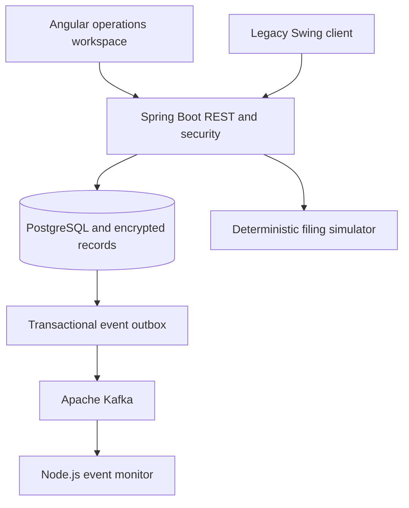

# Architecture

The main application is a modular monolith with controller, business service, repository and relational model layers. Package-private model/repository classes are grouped in `Model.java` and `Repositories.java`; `CageService` owns transaction and report state changes. `Api` exposes application REST actions, `EvidenceApi` protects evidence/subject links, `FilingService` selects the simulation/production boundary, and `Security` maps server-side roles to permissions.

C++17 validation is a separate runnable component, deliberately not invoked in-process by the Java service. The financial write path uses BigDecimal, property-row locking, unique source IDs, and optimistic record versions. At this scale one row lock is simple and testable; production throughput requires measured redesign, not a claim of microservice scale.

Flyway migrates an empty PostgreSQL database before JPA validates it. Synthetic users and records initialize only with DEMO_SEED. All screens read from the API. Authentication is session-based; frontend fetches a session CSRF token before login and after session rotation.

Kafka outbox publication is optional and at least once. A broker outage leaves events available for retry; it cannot roll back an already posted cage transaction. Node's deduplicating durable event store tolerates replay. The local monitor is not a compliance filing adapter or an authenticated public web endpoint.

No employer code, actual patron data, real filing credentials or production performance evidence is included. The resume's historical systems and metrics are not claims about this independent implementation.
